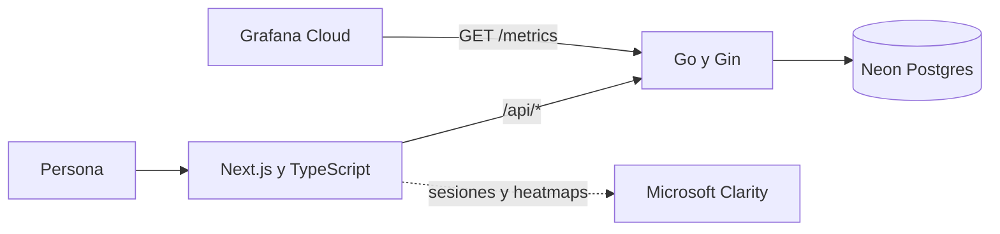

# Hotel Check

Hotel Check es una demo de reservas de propiedades con una prueba de concurrencia integrada. En la interfaz se elige una propiedad y un rango de fechas; el panel de ingeniería envía 50 reservas para ese mismo rango y muestra las respuestas y latencias.

La demo y el dashboard público de métricas se enlazarán aquí cuando estén publicados.

## Arquitectura

Next.js sirve la interfaz y reenvía las llamadas `/api/*` a Go. El navegador no se conecta directamente a la base de datos. La API guarda propiedades y reservas en Neon; Grafana lee sus métricas de `/metrics`, y Clarity registra interacciones con la interfaz.

## La reserva bajo concurrencia

Una comprobación de disponibilidad en la aplicación no basta: dos peticiones simultáneas podrían leer las mismas fechas libres y luego guardar dos reservas. Por eso, PostgreSQL aplica una restricción `EXCLUDE USING gist` sobre la propiedad y el rango de fechas. La base de datos acepta una reserva y rechaza las que se solapan; la API devuelve `201 Created` o `409 Conflict`.

El rango incluye el check-in y excluye el check-out (`[check_in, check_out)`). Una reserva nueva puede empezar el día en que termina la anterior. La extensión `btree_gist` permite combinar la propiedad con la búsqueda de rangos solapados.

Si las fechas están libres antes de iniciar la prueba, el resultado esperado es una reserva confirmada y 49 conflictos. El panel también muestra errores de red o del servidor por separado.

## Tecnologías

- **Go y Gin:** API HTTP, validación de reservas y transacciones.
- **PostgreSQL en Neon:** almacenamiento y protección final contra solapamientos.
- **Next.js App Router, TypeScript y Tailwind CSS:** interfaz de propiedades, calendario y panel de concurrencia.
- **Prometheus y Grafana Cloud:** conteo de intentos, conflictos y latencia.
- **Microsoft Clarity:** heatmaps y grabaciones de sesiones de la interfaz.

## Métricas

La API expone `booking_attempts_total` con el resultado de cada reserva y `booking_duration_seconds` para medir su duración. El dashboard importable está en [`grafana/hotel-check-concurrency.json`](grafana/hotel-check-concurrency.json); muestra confirmaciones, conflictos, latencia media y p95.

`/api/stats` y las métricas se guardan en memoria y vuelven a cero si se reinicia la API. Por eso, la demo está pensada para ejecutarse con una instancia del backend.

## Estructura del código

- `main.go`: inicia la API y registra las rutas.
- `db.go`: conecta con Neon, crea las tablas y carga seis propiedades de ejemplo si la tabla está vacía.
- `handlers.go`: lista propiedades, consulta disponibilidad y crea o limpia reservas de prueba.
- `metrics.go`: define las métricas Prometheus y el resumen de `/api/stats`.
- `src/app/`: páginas, estilos y rutas del frontend.
- `src/components/clarity-tracker.tsx`: inicia Clarity con el ID configurado.
- `grafana/`: dashboard listo para importar en Grafana.
